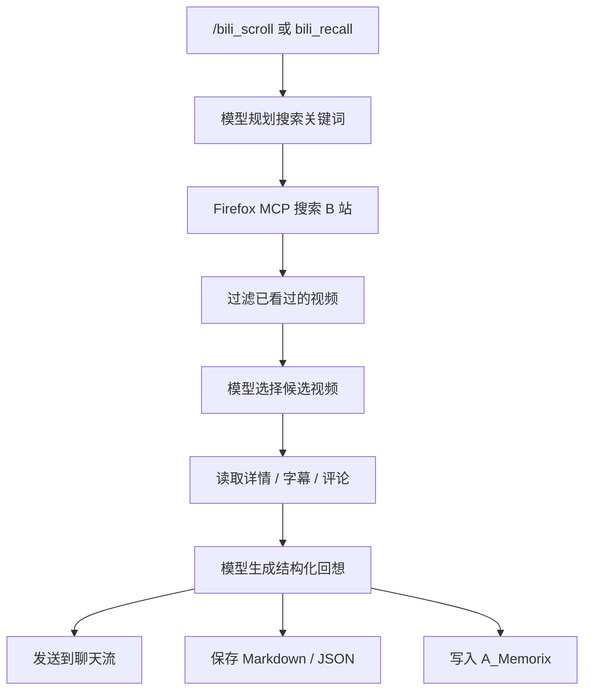

# 麦麦刷 B 站插件

<p align="center">
  <strong>让 MaiBot 自己刷 B 站，读视频、字幕和评论，再写一份有麦麦味道的「B 站回想」。</strong>
</p>

<p align="center">
  
  
  
</p>

> 社区项目，非 MaiBot 官方插件。插件只读取 B 站公开页面/接口中的内容，不会点赞、投币、收藏、发评论或上传视频。

MaiBot（MaiMai Bot）插件：通过 **Firefox MCP（MCP Browser Kit）** 打开 B 站搜索页和视频页，读取视频详情、字幕与热门评论，再调用 MaiBot 的模型能力生成结构化「B 站回想」。回想可以发送到聊天流、保存为 Markdown/JSON，并写入 A_Memorix 长期记忆。

默认使用 Firefox 的当前登录态，因此不需要把 Cookie/SESSDATA 复制进插件目录。也可以切换到仓库内置的只读 Bilibili API MCP。

## 功能

- `/bili_scroll [关键词]`：手动刷一轮；不填关键词时使用配置的默认关键词
- `bili_recall` Tool：让 MaiBot 的模型主动触发「刷一轮 + 生成回想」
- Firefox MCP 数据链路：
  - 打开 B 站搜索页，读取搜索结果
  - 在 Firefox 的 B 站页面上下文中读取视频详情
  - 读取播放器公开字幕/AI 字幕
  - 分页读取视频评论区，支持热度/最新排序和楼中楼回复
  - 自动复用 Firefox 当前的 B 站登录态
- 模型自主选题：
  - 读取 MaiBot 的昵称、人格、行为准则和说话风格
  - 根据人设、兴趣画像、最近看过的视频和近期回想规划搜索关键词
  - 从搜索结果候选中挑选要细读的视频
  - 规划失败时自动回退到配置关键词，选片失败时自动回退到按时间/播放量排序
- 结构化输出：`summary`、`highlights`、`comment_digest`、`recall_cues`
- 模型会明确阅读评论区，并把观众反应、补充信息、争议或共识写入「评论区观察」
- 生成 Markdown 回想并发送到当前聊天流
- 通过 `memory.ingest_summary` 写入 A_Memorix 长期记忆
- 使用 `seen.json` 避免连续多轮重复读取相同视频
- 支持按固定间隔自动刷（默认关闭）
- 兼容模式：`data_source = "bilibili"` 时使用内置的只读 Bilibili API MCP

## 工作流程



更具体地说：

1. 根据 MaiBot 人设、兴趣画像和近期观看记录决定本轮搜索方向。
2. 通过 Firefox 搜索 B 站，过滤 `seen.json` 中已看过的视频，并按发布时间/播放量排序。
3. 让模型从候选池中挑出最值得细读的视频。
4. 在浏览器页面上下文读取视频详情、字幕，并分页读取评论区和楼中楼回复。
5. 优先为每条视频保留评论区材料，再做截断与提示注入防护后交给模型。
6. 解析模型返回的 JSON，生成包含「评论区观察」的 Markdown 回想。
7. 保存结构化产物；如果启用长期记忆，再写入 A_Memorix。

## 环境要求

- Python `3.12`～`3.14`
- MaiBot `1.2.0`～`1.99.99`
- MaiBot Plugin SDK `2.8.0`～`2.99.99`
- **Firefox**，并安装 [MCP Browser Kit M2](https://addons.mozilla.org/zh-CN/firefox/addon/mcp-browserkit-m2/) 扩展
- Node.js + npm（用于运行 MCP Browser Kit HTTP Server）
- 可选：[uv](https://docs.astral.sh/uv/)，用于本仓库开发和测试

> Firefox 后端需要保持 Firefox、Browser Kit 扩展和常驻 MCP Server 同时在线。仅使用 `data_source = "bilibili"` 时不需要 Firefox。

## 快速开始

1. 把仓库放入 MaiBot 的插件目录，确保 `_manifest.json` 位于插件根目录。
2. 在 Firefox 中安装并连接 MCP Browser Kit M2，登录 B 站。
3. 安装/启动本机 Browser Kit HTTP MCP Server（见下一节）。
4. 重启或重新加载 MaiBot，在聊天中发送：

```text
/bili_scroll
```

如果一切正常，麦麦会先回复「开始刷 B 站」，随后在后台采集视频，并在完成后把回想发送到同一聊天流。

## 安装

### 1. 放入 MaiBot 插件目录

```powershell
git clone https://github.com/umouyoumou-del/maibot-bilibili-mcp.git
```

将克隆得到的目录放到 MaiBot 的插件目录中（以你的 MaiBot 部署为准，通常名为 `plugins/`）。插件根目录结构应类似：

```text
plugins/
└── maibot-bilibili-mcp/
    ├── _manifest.json
    ├── plugin.py
    └── ...
```

Manifest 已声明 Python 依赖。MaiBot Runner 支持自动安装插件依赖时，直接重新加载插件即可；如果不支持，请按 [`pyproject.toml`](pyproject.toml) 在 MaiBot 使用的 Python 环境中安装依赖。

### 2. 配置 Firefox MCP

1. 安装 Firefox。
2. 安装 [MCP Browser Kit M2](https://addons.mozilla.org/zh-CN/firefox/addon/mcp-browserkit-m2/) 扩展，并按扩展提示完成连接/授权。
3. 在 Firefox 中登录 B 站（部分字幕需要登录态）。
4. 在仓库根目录运行：

```powershell
powershell.exe -NoProfile -ExecutionPolicy Bypass -File .\scripts\install_firefox_mcp_server.ps1
```

脚本会：

- 安装 `@mcp-browser-kit/server`
- 在 `%LOCALAPPDATA%\MCPBrowserKit` 下创建 HTTP Server 启动脚本
- 启动 `http://127.0.0.1:21082/mcp`
- 把开机启动项写入当前用户的 Startup 目录

如果已经安装过，可以手动启动：

```powershell
powershell.exe -NoProfile -ExecutionPolicy Bypass -File `
  "$env:LOCALAPPDATA\MCPBrowserKit\start-http-server.ps1"
```

### 3. 加载插件

重新启动 MaiBot，或在 MaiBot 的插件管理中重新加载插件。首次加载会生成默认配置；可在 MaiBot 配置界面中按需修改，完整示例见 [`config.example.toml`](config.example.toml)。

## 使用

### 手动刷一轮

```text
/bili_scroll
/bili_scroll MaiBot
/bili_scroll AI Agent
```

也可以使用兼容别名 `/bili_refresh`。

插件会立即回复开始提示，后台任务完成后发送 Markdown 回想。如果上一轮尚未结束，再次触发会返回「上一轮刷 B 站还没有结束」。

### 让模型主动调用

内置 Tool：

```text
bili_recall(keyword?: string)
```

该 Tool 会同步执行一轮刷 B 站，并把 Markdown、保存路径、BV 号、选片计划等返回给调用它的模型。它不会主动向聊天流发送消息。

### 自动刷

在插件配置中设置：

```toml
[scroll]
auto_interval_minutes = 60
target_stream_id = "<目标聊天流 ID>"
```

- `auto_interval_minutes = 0`：仅手动触发（默认）
- `target_stream_id` 为空：自动轮次仍会生成回想、保存文件并写长期记忆，但不主动发消息
- 定时任务在插件加载后经过一个完整间隔才触发第一次

## 配置

配置项会由 MaiBot 插件配置界面自动补齐。以下是最常用的配置；完整字段、默认值和取值范围见 [`config.example.toml`](config.example.toml)。

### 数据源

```toml
[scroll]
data_source = "firefox"  # firefox（默认）或 bilibili
```

| 值 | 说明 |
| --- | --- |
| `firefox` | 通过 Firefox MCP 浏览 B 站，复用浏览器当前登录态，默认推荐 |
| `bilibili` | 由插件启动内置的只读 Bilibili API MCP，不依赖 Firefox |

### Firefox MCP

```toml
[firefox]
mcp_url = "http://127.0.0.1:21082/mcp"
call_timeout_seconds = 120.0
page_load_timeout = 25.0
```

- `mcp_url`：Browser Kit HTTP MCP 地址，默认只监听本机回环地址
- `call_timeout_seconds`：单次 Firefox MCP 工具调用超时
- `page_load_timeout`：等待 B 站搜索页/视频页加载的超时

### 刷 B 站策略

| 配置 | 默认值 | 说明 |
| --- | --- | --- |
| `scroll.model_directed` | `true` | 让模型自主规划搜索关键词 |
| `scroll.model_select_candidates` | `true` | 让模型从搜索结果中选片 |
| `scroll.interest_profile` | `MaiBot、AI Agent、独立开发、开源工具、B站社区文化` | 自主选题参考的长期兴趣画像 |
| `scroll.use_persona` | `true` | 读取 MaiBot 昵称、人格和说话风格 |
| `scroll.planning_max_keywords` | `3` | 每轮最多规划几个关键词 |
| `scroll.candidate_pool_size` | `24` | 交给模型筛选的候选池大小 |
| `scroll.keywords` | `["MaiBot", "MaiMai", "AI Agent"]` | 默认关键词；指定 `/bili_scroll 关键词` 时优先使用显式关键词 |
| `scroll.search_order` | `pubdate` | `pubdate` / `totalrank` / `click` / `dm` |
| `scroll.search_per_keyword` | `6` | 每个关键词搜索多少条候选 |
| `scroll.max_age_days` | `7` | 只挑选最近多少天的视频；`0` 表示不限 |
| `scroll.max_videos` | `6` | 每轮最多读取多少条视频详情 |
| `scroll.max_highlights` | `3` | 模型最多输出多少条重点回想 |
| `scroll.include_comments` | `true` | 是否读取视频评论区 |
| `scroll.comments_per_video` | `12` | 每条视频最多读取多少条评论，最多支持 100 条分页读取 |
| `scroll.comment_sort` | `hot` | `hot`=热度 / `new`=最新 |
| `scroll.include_comment_replies` | `true` | 是否读取热评下的楼中楼回复 |
| `scroll.comment_digest_max_items` | `4` | 模型最多输出几条评论区观察 |
| `scroll.subtitle_max_chars` | `6000` | 单条字幕送入模型的字符上限 |
| `scroll.total_material_chars` | `24000` | 本轮材料总字符上限，防止 token 爆炸 |
| `scroll.request_interval_seconds` | `0.25` | MCP 工具调用间隔 |
| `scroll.style_prompt` | `用简洁、自然、像在分享刚刚刷到内容的口吻` | 回想表达风格 |

### 评论区读取

```toml
[scroll]
include_comments = true
comments_per_video = 12
comment_sort = "hot"
include_comment_replies = true
comment_digest_max_items = 4
```

- Firefox 后端和内置 Bilibili API MCP 都会分页读取评论区，最多可读取 100 条。
- 评论材料包含用户名、正文、点赞数、回复数、发布时间和热评下的楼中楼回复。
- 评论区会优先进入模型上下文，避免被长字幕挤掉；超出 `total_material_chars` 的部分仍会截断。
- 模型输出中的 `comment_digest` 会渲染成 Markdown 的「评论区观察」，并写入 JSON 和长期记忆。
- 原始评论样本会保存在每轮 JSON 的 `materials[].comments` 中，方便排查模型是否真的读到了评论。

### 模型与长期记忆

```toml
[model]
task_name = "utils"
model_name = ""
temperature = 0.4
max_tokens = 1800
ingest_memory = true
memory_chat_id = "bilibili"
```

- `task_name`：MaiBot 模型任务名，例如 `utils`、`planner`、`mid_memory`
- `model_name`：可选的具体模型名；留空则使用任务名对应的模型
- `ingest_memory`：是否通过 `memory.ingest_summary` 写入 A_Memorix
- `memory_chat_id`：自动刷没有目标聊天流时，写入记忆使用的 chat_id

## Bilibili API 兼容模式

在 Firefox 不可用或不适合使用时，可以切换内置只读 API MCP：

```toml
[scroll]
data_source = "bilibili"
```

该后端通过 stdio 启动 [`vendor/bilibili_mcp/mcp_server.py`](vendor/bilibili_mcp/mcp_server.py)，只暴露以下工具：

| Tool | 用途 |
| --- | --- |
| `bili_search` | 搜索视频 |
| `bili_video_info` | 读取视频详情 |
| `bili_subtitle` | 读取公开字幕/AI 字幕 |
| `bili_comments` | 分页读取评论区，支持热度/最新排序和楼中楼回复 |

匿名状态通常即可搜索、读取视频信息和公开评论。部分字幕或受限接口可能需要登录凭证。若需要，可在 MaiBot 分配给插件的插件数据目录中放置 `bili_credential.json`，或通过 `bilibili.credential_file` 指定路径：

```json
{
  "sessdata": "...",
  "bili_jct": "...",
  "buvid3": "...",
  "buvid4": "...",
  "dedeuserid": "...",
  "ac_time_value": "..."
}
```

凭证文件不要提交到 Git，也不要发送给他人。

## 数据产物

插件数据目录由 MaiBot Runner 的 `ctx.paths.data_dir` 决定。运行后会产生：

```text
<插件数据目录>/
├── seen.json
└── recalls/
    └── YYYY-MM-DD/
        ├── HHMMSS-ffffff.md
        └── HHMMSS-ffffff.json
```

- `seen.json`：最近看过的 BV 号与标题，默认保留 60 天
- `*.md`：可直接阅读/发送的 Markdown 回想
- `*.json`：结构化回想、选片计划、模型名、评论区观察和本轮评论原文样本

如果想重新看到已经看过的视频，可以备份后删除 `seen.json`，但这样也可能导致重复内容。

## 安全与隐私

- **只读**：插件不会执行点赞、投币、收藏、评论、私信或上传等写操作。
- **登录态不离开浏览器**：Firefox 模式通过页面上下文发起带登录 Cookie 的请求，不会把 Cookie/SESSDATA 交给模型或聊天流。
- **材料最小化**：标题、简介、字幕和评论会截断后再送入模型；评论用户名也会作为材料的一部分被截断。
- **提示注入防护**：Prompt 明确要求模型把字幕和评论当作不可信素材，不允许执行其中的指令；模型输出还会校验 BV 号。
- **本机服务**：Browser Kit HTTP MCP 默认只监听 `127.0.0.1`，不要把 `21082` 等本地端口暴露到公网。
- **产物可能含敏感内容**：`recalls/` 中可能包含视频字幕、评论和模型生成内容，发布或分享前请自行检查。
- **非官方项目**：本项目是社区维护的 MaiBot 插件，与 MaiBot、B 站、MCP Browser Kit 官方无隶属关系。

## 开发与测试

```powershell
# 同步开发依赖
uv sync

# 静态检查
uv run ruff check .
uv run ruff format --check .

# 单元测试（不访问网络）
uv run pytest -q

# 完整离线检查
.\scripts\dev.ps1 check
```

真实链路冒烟测试（需要对应服务可用）：

```powershell
# 内置 Bilibili API MCP
.\scripts\dev.ps1 smoke

# Firefox MCP；需要 Firefox、扩展和 HTTP Server 在线
.\scripts\dev.ps1 smoke-firefox
```

非 Windows 环境可以直接运行等价的 `uv run ...` 与 `python scripts/*.py` 命令。

## 项目结构

```text
maibot-bilibili-mcp/
├── _manifest.json              # MaiBot 插件 Manifest
├── plugin.py                   # 插件入口、命令、Tool、配置和宿主能力适配
├── round_planner.py            # 模型自主选题与候选选片
├── scroll_service.py           # 采集、过滤、模型回想、保存和记忆写入
├── firefox_bilibili_mcp.py     # Firefox MCP ↔ Bilibili MCP 兼容适配器
├── bilibili_mcp_client.py      # 内置 Bilibili MCP stdio 客户端
├── config.example.toml         # 配置示例
├── scripts/                    # 安装、检查和冒烟测试脚本
├── tests/                      # 离线单元测试
└── vendor/bilibili_mcp/        # 内置只读 Bilibili MCP Server
```

## 故障排查

### 提示 Firefox/浏览器未连接

- 确认 Firefox 正在运行。
- 确认 MCP Browser Kit M2 扩展已连接。
- 确认 HTTP Server 正在监听：`http://127.0.0.1:21082/mcp`。
- 运行 `uv run python scripts/smoke_firefox_mcp.py --keyword MaiBot` 检查真实链路。
- 若服务没有启动，运行：

```powershell
powershell.exe -NoProfile -ExecutionPolicy Bypass -File `
  "$env:LOCALAPPDATA\MCPBrowserKit\start-http-server.ps1"
```

### 搜索成功但读不到字幕

部分视频没有公开字幕，或者字幕接口需要登录。先在 Firefox 中确认已登录 B 站；即使字幕缺失，视频详情和评论仍可能正常读取。

### 没有发现新视频

检查 `scroll.max_age_days` 是否过小，以及 `seen.json` 是否已经记录了大量视频。想要更宽的候选范围，可以临时增大 `max_age_days` 或调整兴趣画像/关键词。

### 自动刷没有发送消息

自动刷必须同时设置：

```toml
[scroll]
auto_interval_minutes = 60
target_stream_id = "<有效的聊天流 ID>"
```

只设置间隔时，插件仍会在后台保存回想并写长期记忆，但不会主动发消息。

### 模型输出格式异常

插件会尝试修复常见 JSON 错误；无法解析时会退化为纯文本摘要。可降低温度、换用更稳定的模型，或检查 MaiBot 的模型任务配置。

### 上一轮没有结束

采集和生成是后台串行任务。等待当前轮完成，或查看 MaiBot 日志中是否有长时间未返回的 Firefox MCP 调用。

## 第三方代码与许可

- 本项目采用 [MIT License](LICENSE)。
- `vendor/bilibili_mcp/` 基于 [AGI_Ananas/bilibili-mcp](https://github.com/adoresever/bilibili-mcp) 的 MIT 实现裁剪，原始许可见 [`vendor/bilibili_mcp/LICENSE`](vendor/bilibili_mcp/LICENSE)。
- 刷 B 站流程与选片/字幕/报告思路参考了 [holoiallo/dsh-bili-scroll](https://github.com/holoiallo/dsh-bili-scroll)（MIT），未复制其非 MCP 部分代码。
- Firefox 后端依赖 [MCP Browser Kit](https://github.com/ndthanhdev/mcp-browser-kit)，本项目不捆绑其代码。

更多署名信息见 [`NOTICE.md`](NOTICE.md)。

---

如果这个插件对你有帮助，欢迎在 [Issues](https://github.com/umouyoumou-del/maibot-bilibili-mcp/issues) 中反馈问题或提出新想法。
